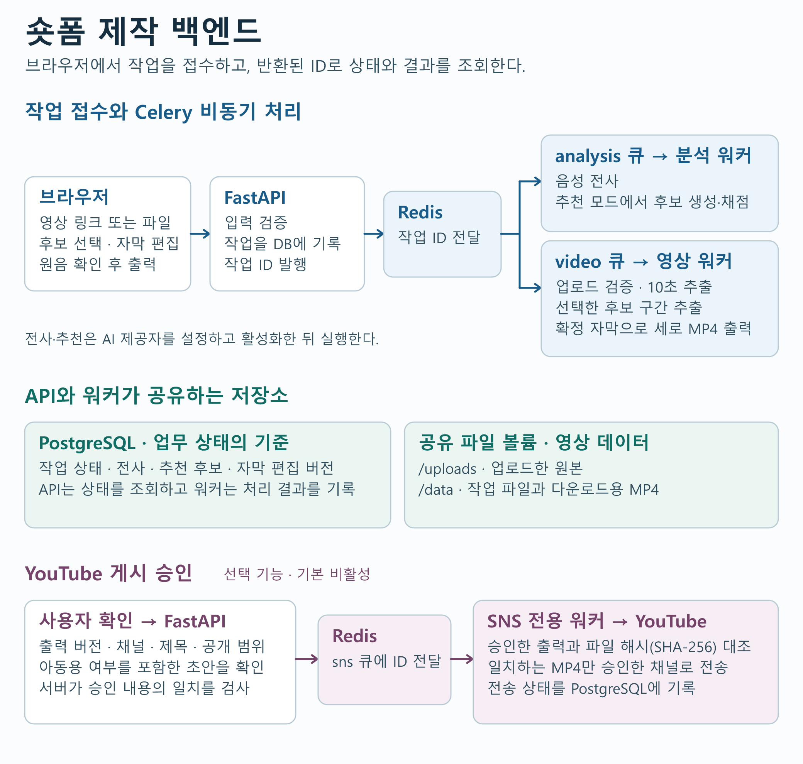

# Shortform Harness

FastAPI + PostgreSQL + Redis + Celery 기반 숏폼 서비스의 초기 개발 기반입니다. 현재는 상태 점검과 워커 진단만 구현했으며 영상·AI·웹 편집·SNS 기능은 아직 없습니다.

**[프로젝트 위키 시작하기](wiki/README.md)** — 문제 정의, 단계별 계획, 구조·기술 선택, 개발 하네스와 운영 절차를 카테고리별로 관리합니다.



[아키텍처 SVG](docs/architecture.svg) · [현재 구현 현황](wiki/07-governance/status.md) · [단계별 계획](wiki/02-delivery/roadmap.md)

## 빠른 시작

저장소 루트에서 실행합니다. Docker Desktop의 Linux 엔진, uv와 Python 3.12가 필요합니다.

```powershell
uv sync --locked
uv run python scripts/verify.py
docker compose up --build -d
curl.exe http://localhost:8000/health/live
curl.exe http://localhost:8000/health/ready
```

API 문서: http://localhost:8000/docs

준비 상태 점검은 PostgreSQL·Redis 연결만 확인합니다. 워커 실행은 별도 통합 검사로 확인합니다. Compose는 로컬 개발용이며 공개 배포 구성이 아닙니다.

## 상세 안내

| 목적 | 문서 |
|---|---|
| 처음 합류했을 때 | [온보딩](wiki/05-development/onboarding.md) |
| 시스템 이해 | [구조](wiki/03-architecture/system-overview.md), [흐름](wiki/03-architecture/runtime-flows.md) |
| 다음 개발 | [영상·작업 처리 단계](wiki/02-delivery/phase-02-video-jobs.md) |
| 검사 실행 | [검증 절차](wiki/05-development/verification.md) |
| AI와 작업 | [AGENTS.md](AGENTS.md), [하네스](wiki/05-development/harness-workflow.md) |
| 실행 오류 | [점검 절차](wiki/06-operations/runbook.md) |
| 문서 추가 | [문서 관리 규칙](wiki/07-governance/document-guide.md) |

## 저장소 구조

```text
app/          # API·DB·Celery 설정, 향후 업무 모듈 경계
migrations/   # Alembic 환경, 업무 테이블 없음
tests/        # 단위·인프라 통합 검사
scripts/      # 검사 진입점·다이어그램 생성
wiki/         # 카테고리별 프로젝트 문서
docs/         # 다이어그램과 이전 문서 링크 안내
.github/      # CI·PR 양식
```

GitHub Actions는 검사와 Docker 빌드를 실행하며 자동 배포·유료 AI 호출을 하지 않습니다. 필수 검사 병합 차단은 별도 저장소 규칙이 필요합니다.
