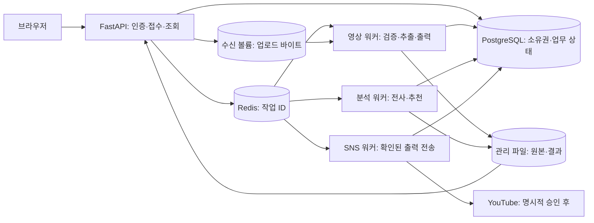
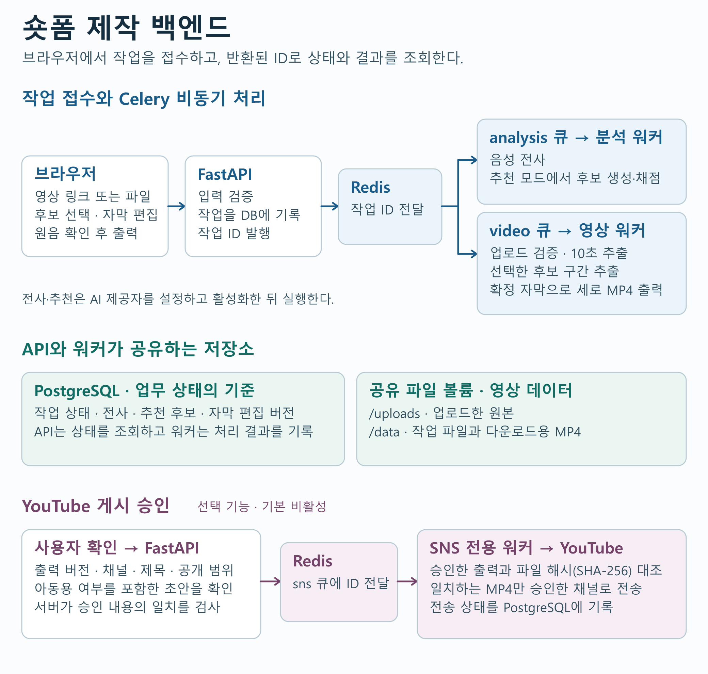

# 시스템 구조와 책임 경계

> 오래 걸리는 영상 처리를 웹 요청에서 분리하고 업무 상태와 파일을 따로 관리합니다. 각 구성 요소가 무엇을 책임지는지와 코드 계층을 나눈 이유를 설명합니다.

[위키 홈](../README.md) · [카테고리 목차](README.md)

## 현재 서비스 구성

Redis는 영상 파일이 아니라 작은 작업 ID를 전달합니다. 워커가 파일을 처리하고 DB에 상태를 기록하며 API는 그 상태를 조회합니다. 관리 원본 볼륨은 API에 읽기 전용으로 연결합니다. 객체 저장소는 이 구성에 포함되지 않습니다.

## 구성도

[SVG 원본](../../docs/architecture.svg). 그림은 초기 상태 점검·진단 시점의 스냅샷이다. VIDEO-002의 최신 연결은 아래 설명과 실행 흐름 문서를 기준으로 한다. 그림은 특정 클라우드 배포 완료를 뜻하지 않는다.

이 그림은 API·워커 서비스 연결 기준이다. 추가된 [로컬 영상 CLI](../05-development/video-extraction.md)는 별도로 `링크 → 다운로드 → FFmpeg → 검사 → 로컬 출력`을 실행한다. VIDEO-002는 API·DB·Redis·Celery와 영상 서비스를 연결했다. 파일은 워커 쓰기/API 읽기 전용 공유 볼륨을 사용한다. 객체 저장소는 미구현이다.

## 역할과 데이터 소유권

| 구성 | 책임 | 맡기지 않을 책임 |
|---|---|---|
| 웹 UI | 입력·후보 비교·편집·상태 표시 | 비밀키 보관, 실제 완료 여부 추정 |
| FastAPI | 요청·소유권 검증·작업 등록·조회 | HTTP 요청 안에서 긴 인코딩 수행 |
| PostgreSQL | 서비스 데이터·현재 video_jobs 상태의 기준 | 큰 영상 파일 전달 |
| Redis | 워커에 작은 작업 메시지 전달 | 제품 작업의 유일한 이력 저장소 |
| Celery 워커 | Python 업무 함수 실행·동시성 관리 | 추천 알고리즘 자체 제공 |
| 분석·FFmpeg adapter | 모델·외부 도구 실행 | 사용자 접근 권한의 최종 결정 |
| 로컬 공유 볼륨 | 원본·중간 파일·출력 파일 저장 | 편집 버전·작업 상태 관리 |

현재 웹·전사 기반 분석·편집 출력은 연결돼 있다. 객체 저장소는 후속 설계이며 현재 파일은 로컬 공유 볼륨에 보관한다. API와 워커는 하나의 코드 저장소·이미지를 공유하고 프로세스만 나눈다. 업무를 서비스별 독립 저장소로 분리하지 않는다.

## 코드 계층

| 위치 | 현재 내용 | 향후 책임 |
|---|---|---|
| app/main.py | 인증·업로드·분석·출력 라우터 조립 | HTTP 경계 유지 |
| app/config.py | 환경 변수 | 외부 설정 검증 |
| app/db.py | SQLAlchemy 연결·Base | DB 세션·모델 기반 |
| app/worker.py | Celery·진단·영상 작업 | 작업 등록과 업무 함수 호출 |
| app/domain/ | 10초 구간·출력 검사 규칙 | 점수·업무 상태 전이 규칙 |
| app/services/ | 링크에서 영상 추출·결과 기록 | 분석·출력 사용 사례 조정 |
| app/adapters/ | 다운로드·FFmpeg·FFprobe·프로세스 제어 | 모델·객체 저장소 연결 |
| app/cli/ | URL·시작 시간 입력과 JSON 응답 | 개발·수동 검증 진입점 |

향후 domain은 FastAPI·Celery·외부 SDK를 직접 알지 않도록 설계한다. services가 필요한 기능을 조정하고 adapters가 외부 통신을 수행한다. 초기에 범용 추상화 프레임워크를 만들 필요는 없다.

## 확장 경계

초기 Compose는 한 개발 환경에서 실행한다. API에 부하가 전파되거나 작업 대기가 늘면 워커를 별도 호스트로 옮긴다. 파일을 공유 저장소에 두고 메시지에 파일 바이트를 넣지 않는 이유가 여기에 있다. GPU는 필요한 분석 단계만 별도로 도입한다.

관련: [현재·목표 흐름](runtime-flows.md), [기술 결정](../04-decisions/README.md).

작성 시점과 상태 이력

> 상태: 현재 구성 + 목표 설계 · 기준일: 2026-11-15 · 유지관리: 프로젝트 개발자

