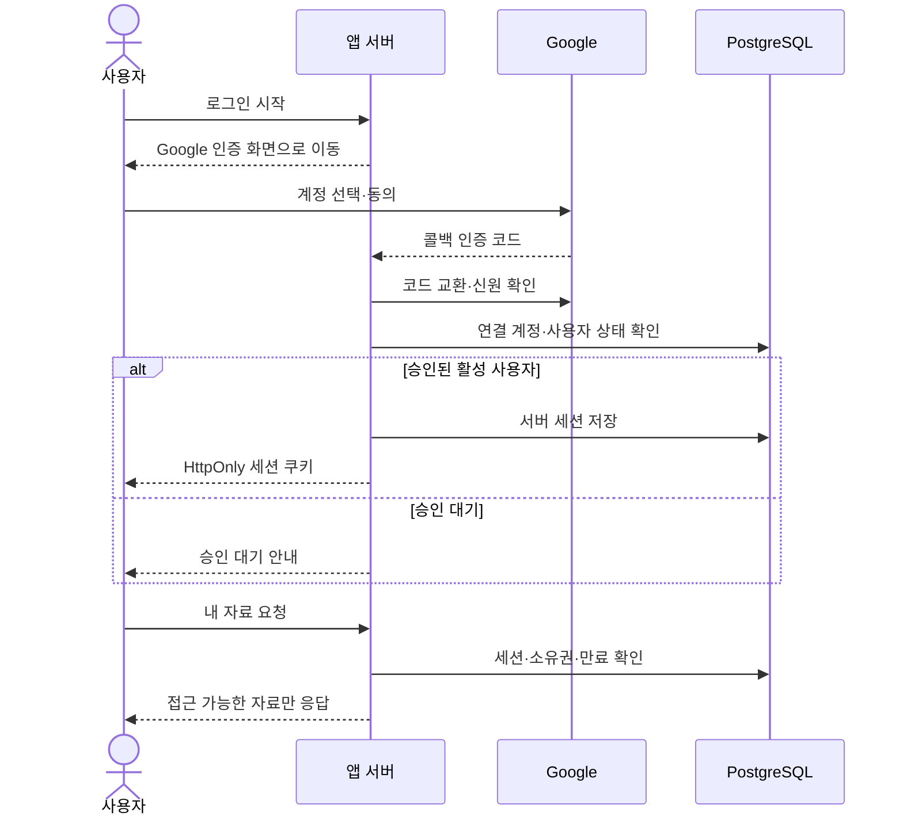

# Google 로그인과 7일 자료 관리 — AUTH-DATA-001

> Google 로그인으로 사용자를 식별하고 영상·출력을 계정별로 보호합니다. 설정과 테스트 사용자 승인, 새 자료 7일 보관, 삭제·탈퇴 및 사용 중 자료 처리 방법을 안내합니다.

[위키 홈](../README.md) · [개발 목차](README.md)


## Google 로그인과 서버 세션



Google 신원 확인과 앱의 사용자 승인은 별도입니다. 이 로그인은 YouTube 게시 권한을 부여하지 않으며, 그 권한은 SNS 연결에서 따로 요청합니다.

## 동작과 설정

로그인·운영자 승인·서버 세션, 사용자 소유권 검사, 내 자료 목록·삭제·탈퇴, 새 자료의 7일 만료를 추가했다. 로그인용 토큰 검증에 `google-auth[requests]`를 추가했으며 자체 JWT 서명 검증기를 만들지 않는다. YouTube 연결 설정과 분리한다. [설계와 변경 배경](../03-architecture/user-auth-data-management.md)을 함께 읽는다.

로컬 호환성을 위해 `ENABLE_AUTH` 기본값은 false다. 인증 모드를 켜면 기존 소유자 없는 자료는 조회·재사용할 수 없고, 기존 SNS 연결도 다시 연결한다. 기존 자료를 자동 이전하거나 삭제하지 않는다. development/test 외 환경에서 인증이 꺼져 있거나 HTTPS Origin이 아니면 요청을 거부한다.

환경 변수는 비공개 실행 환경에 주입한다.

```text
ENABLE_AUTH=true
AUTH_ORIGIN=http://localhost:8000
GOOGLE_LOGIN_CLIENT_ID=<로그인 전용 클라이언트 ID>
GOOGLE_LOGIN_CLIENT_SECRET=<로그인 전용 비밀값>
```

Google에 등록할 로그인 콜백은 `AUTH_ORIGIN`의 `/auth/google/callback`이다. 비밀번호 가입은 없다. 초기 계정은 pending으로 등록되고 승인 전 업무 세션을 발급하지 않는다. 사용자에게 표시된 요청 ID를 확인해 운영자가 승인한다.

```powershell
uv sync --locked
uv run python -m app.cli.manage_users pending
uv run python -m app.cli.manage_users approve --user-id <확인한-요청-ID>
```

DB migration은 실제 적용 대상을 확인한 뒤 수행한다. 기존 개발 DB에 자동 적용하지 않는다. `0005_auth_data`는 기존 자료를 legacy로 보존하며 소유권을 제거하는 downgrade는 거부한다. 전환 전 DB·관리 파일 백업, 접수 중단, 실제 워커 종료를 확인한다.

## 자료와 삭제

`/login`에서 로그인하고 `/my-data`에서 원본·출력의 만료, 삭제 범위를 확인한다. 업무 자료는 사용자별로 분리하고 음성·영상 Range, SRT·검증 자료도 동일하게 보호한다. 미로그인은 401, 타인 자료는 404, 본인 자료의 만료·삭제 중 상태는 410이다. HTML 검증 자료는 인증 모드에서 첨부 다운로드로 제공한다.

원본 삭제는 전사·분석·검수·후보·출력·검증 파일을 포함한다. 출력 삭제는 해당 출력만 정리한다. 같은 삭제 요청은 재사용한다. 파일·DB 정리가 끝나야 complete다. 외부 경로와 링크를 거부하며 YouTube에 게시한 영상은 삭제하지 않는다.

정리 프로세스는 별도 실행한다. API 파일 마운트의 읽기 전용 상태를 유지한다.

```powershell
uv run python -m app.cli.cleanup_data --dry-run
uv run python -m app.cli.cleanup_data
uv run python -m app.cli.cleanup_data --loop
```

Compose에서는 인증 설정 후 `auth` 프로필의 cleanup 프로세스를 사용한다. 루프는 60초마다 만료와 삭제 접수를 검사한다. 파일 오류는 최대 3회 처리하고 failed로 남긴다. 기본 동작은 설정된 실제 DB·파일을 변경하므로 대상 환경을 확인한다.

세션은 유휴 24시간·절대 7일이며 자동 조회는 유휴 기한을 늘리지 않는다. 계정 탈퇴는 5분 내 재인증이 필요하고 모든 앱 세션을 폐기한다. 탈퇴 후 제한된 삭제 조회 토큰으로 진행 상태만 조회할 수 있다.

## 사용 중 자료와 장애

요청·다운로드·워커는 resource_uses를 남기고 정상 종료 시 제거한다. 사용 중에는 삭제를 거부/보류한다. 첫 버전은 안전을 위해 같은 사용자의 다른 요청이 진행 중이어도 정리를 보류한다. 로그아웃은 접수한 작업을 취소하지 않는다.

프로세스가 강제 종료되면 사용 기록이 남을 수 있다. 시간 경과만으로 제거하지 않는다. 운영자가 해당 API/워커·하위 프로세스 종료와 SNS 전송 상태를 확인한 뒤 해당 사용자·자원·기록 ID만 대상으로 DB 기록을 정리한다. running·unknown 작업의 수동 처리는 [기존 실행 중단 절차](async-video-jobs.md)를 따른다. queued 작업의 만료 또는 탈퇴는 외부 호출 없이 실패 상태로 종결한다. 자동 복구나 외부 게시 취소를 보장하지 않는다.

삭제 정리는 파일부터 지운 뒤 DB 민감 내용을 제거한다. 중간 실패 시 재실행할 수 있고 DB에는 실패 상태를 남긴다. 완료 이력은 30일 후 정리하며, 자료에는 내용 없는 내부 ID·소유권·삭제 표식이 남는다. 운영 백업과 복구 시 삭제 반영은 별도 배포 전 검증 사항이다.

## 검사와 제한

일반 검사는 외부 Google·AI·SNS에 접속하지 않는다. `tests/integration/test_auth_data.py`는 별도의 폐기 가능한 PostgreSQL을 준비하고 migration을 적용한 다음 `AUTH_TEST_DATABASE_URL`과 `RUN_INTEGRATION=1`로 실행한다. 실제 Google 로그인·클라이언트 설정·동의 화면은 일반 검사와 분리해 테스트 계정으로 확인한다. 키나 사용자 자료를 일반 테스트에 주입하지 않는다.

2026-11-17에는 커밋 `94f2474`의 인증 코드를 고정한 별도 로컬 API·DB·Redis에서 실제 Google 테스트 계정 1개의 로그인을 확인했다. 로그인 전용 웹 클라이언트와 `http://localhost:8002/auth/google/callback`을 등록하고, 계정 선택·동의 후 pending 등록, 운영자 승인 후 내 자료 접근, 새로고침 시 세션 유지, 로그아웃 후 서버 세션 제거와 보호 화면 접근 차단을 검증했다. API 접근 로그는 끄고 비밀값은 Git 제외 `.env`로만 주입했다. 기존 8000 개발 DB·자료·SNS 연결은 전환하지 않았다.

기본 검사, 전용 DB 검사, 격리 Celery·Chromium 통합 결과와 미실행 항목은 [작업 기록](harness/records/2026-11-17-auth-data-plan.md)에 남긴다. 운영 배포·HTTPS 운영 쿠키·기존 사용자 자료 삭제·다른 계정의 실제 로그인은 이번 실계정 검증에 포함하지 않는다.

<details>
<summary>작성 시점과 상태 이력</summary>

> 상태: 로컬 구현 / 격리 환경의 실제 Google 로그인·로그아웃 확인 · 기준일: 2026-11-17

</details>
