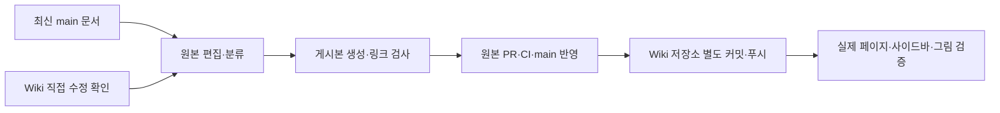

# 위키 작성·변경 규칙

> 문서가 늘어나도 처음 읽는 사람이 목적과 현재 상태를 파악할 수 있어야 합니다. 요약·설명 순서·근거 표기와 카테고리 관리, 원본과 GitHub Wiki 게시 절차를 정합니다.

[위키 홈](../README.md) · [카테고리 목차](README.md)

## 원본과 Wiki 게시의 관계

코드 저장소의 wiki/ 원본을 main에 반영해도 GitHub Wiki는 자동 갱신되지 않습니다. 게시 전에 Wiki 직접 변경을 대조하고, 게시 후 실제 렌더링까지 확인합니다.

## 저장 위치와 목적

공식 문서는 **[GitHub Wiki](https://github.com/Juhye0k/short-form/wiki)**에 게시한다. Wiki는 별도 `short-form.wiki.git` 저장소를 사용하며 Home, 카테고리 목차, 세부 Markdown 페이지와 공통 사이드바로 구성한다. 코드 저장소의 wiki/ 폴더는 카테고리별 게시 원본이다.

## 처음 읽는 사람을 위한 편집 기준

제목 바로 아래에 `>` 인용 블록으로 글의 문제와 읽은 뒤 알 수 있는 내용을 두세 문장으로 쓴다. 이 블록은 문서 자체의 요약이며 외부 발언 인용이 아니다. 상태·커밋·게시 이력을 요약 대신 놓지 않는다.

설계 글은 문제와 결론, 선택 이유, 실제 동작, 검증과 한계를 연결한다. 명세는 요청·응답·오류 표를, 실행 안내는 준비·명령·성공 확인·실패 대응 순서를 유지한다. 작업 기록은 실제 결과를 앞에 두고 프롬프트와 시행착오는 뒤에서 날짜·버전별로 설명한다.

문단 하나는 한 가지 내용을 설명한다. 전문 용어는 처음 등장할 때 풀어 쓰고, 작업 ID는 설명 뒤에 붙인다. 표는 항목 비교에, 목록은 나란한 항목이나 실행 순서에 사용한다. 수치를 줄이거나 assertion을 바꾸어 미달을 성공처럼 표현하지 않는다.

현재 설명과 과거 계획이 충돌하면 현재 구현을 먼저 설명하고 과거 수치·실패·판단은 작성 시점이 있는 기록으로 보존한다. 안전·비용 경고는 실행 절차 앞에 남기고 단순 게시 이력은 글 끝으로 옮긴다.

## 탐색 구조와 게시 원본

`navigation.json`은 모든 Markdown 원본에 주 카테고리를 하나씩 지정한다. 물리 경로와 기존 Wiki 주소는 유지하며 화면의 카테고리는 독자 목적에 따라 묶는다. 오른쪽 카테고리는 펼치기 전용이고 안의 글 링크는 해당 페이지로 직접 이동한다.

`python scripts/build_wiki.py --output .tmp/wiki-preview`는 본문 링크·분류 누락·중복 주소·요약을 검사하고 Home·본문·접이식 사이드바를 생성한다. 실제 Wiki를 수정하거나 원격으로 게시하지 않는다. 생성 결과를 검토한 뒤 Wiki 최신 변경과 대조해 게시한다.

## 참고한 글 구성

문제·가설·해결 과정을 나누는 [토스 사례](https://toss.tech/article/Various-attempts-to-solve-the-problem), 문제와 해결을 먼저 알리는 [D2 글 목록의 도입부](https://d2.naver.com/helloworld?page=4), 짧은 요약 뒤 사례를 설명하는 [카카오페이 사례](https://tech.kakaopay.com/post/troubleshooting-logs-as-a-junior-developer/), 주제별 입구를 나눈 [당근 기술 블로그](https://medium.com/daangn)를 참고했다. 문구·성과·그림은 차용하지 않는다.

## 한 문서의 책임

- 제품 문서: 사용자 문제·가치·범위.
- 단계 문서: 목적·진입 조건·설계·산출물·완료 기준.
- 아키텍처 문서: 역할·데이터·동작 경계.
- ADR: 왜 이 기술·방식을 선택했는지와 재검토 조건.
- 개발·운영 문서: 실행 가능한 절차와 실패 시 확인 방법.
- 현황 문서: 커밋·검사 결과·미구현 상태.

같은 상세 설명을 여러 문서에 복사하지 않고 기준 문서에 링크한다. 루트 README는 실행 입구이며 전체 설계서가 아니다. 기존 docs/architecture.md와 docs/harness.md는 이전 링크를 유지하는 안내 문서다.

프롬프트·결과와 포트폴리오 근거는 [작업 기록 절차](../05-development/harness/records/README.md)를 따른다. 공개 가능한 프롬프트 발췌 또는 비식별 요약을 사용하고, 원문·일부 생략·요약 여부를 표시한다. 원본 대화 전체·개인 자료·비밀값은 게시하지 않는다. 로컬 기록 갱신과 GitHub Wiki 게시 상태를 구분한다.

## 상태 표기

| 상태 | 의미 |
|---|---|
| 프로젝트 기준/채택 | 현재 합의한 목적 또는 결정 |
| 현재 실행 절차/구현 완료 | 코드와 실행 증거가 있는 내용 |
| 설계 초안/후속 계획 | 구현·검증되지 않은 제안 |
| 스냅샷 | 특정 날짜·커밋 기준 현황 |

'채택'이 '구현 완료'를 의미하지 않는다. 수치 목표와 예시도 구분한다. 날짜·버전·성과를 추측해 채우지 않는다.

## 파일과 링크

파일명은 영문 소문자와 하이픈, 제목·본문은 한국어를 기본으로 한다. 카테고리마다 README.md 목차를 두고 세부 문서는 위키 홈과 카테고리로 돌아갈 링크를 포함한다. 원본 내부 링크는 저장소 상대 경로를 사용하며 Wiki 게시 시 페이지 URL로 변환한다. 코드 링크는 본 저장소로, 문서 링크는 Wiki 페이지로 연결한다. 개인 PC 경로와 참고 원본을 공개 문서에 넣지 않는다.

## 변경 완료 조건

관련 코드와 대조하고 내부 링크·이미지 경로·명령을 검토한다. 상태 변경 시 [현황](status.md)과 [로드맵](../02-delivery/roadmap.md)을 함께 확인한다. 외부 서비스의 최신 요금·정책을 새로 주장할 때는 공식 출처와 확인일을 기록한다.

## Wiki 변경 반영

원본을 변경한 뒤 Wiki 저장소를 pull하고 해당 페이지를 갱신해 별도로 커밋·푸시한다. 본 저장소 push만으로 Wiki가 자동 갱신되지는 않는다. Wiki에서 직접 수정했다면 다음 게시 전에 원본에도 반영해 덮어쓰기를 방지한다. 게시 후 Home·사이드바·세부 문서·이미지가 실제로 열리는지 확인한다.

작성 시점과 상태 이력

> 상태: 문서 관리 기준 · 기준일: 2026-11-15 · 유지관리: 프로젝트 개발자

